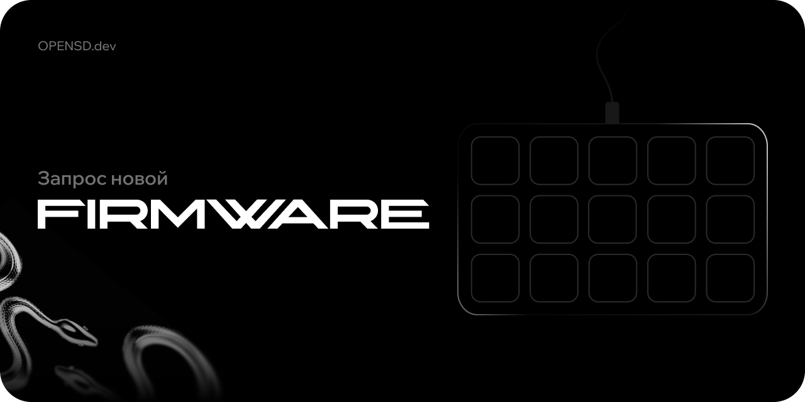

# Open Stream Deck: прошивки и запросы

Готовые прошивки Open Stream Deck для дек сторонних производителей и запросы на новые модели. Прошивка заменяет штатную и позволяет управлять декой из [Open Stream Deck](https://wiki.opensd.dev).

[English below](#english)

## Готовые прошивки

| Дека | Кнопки и экран | Репозиторий | Скачать |
| --- | --- | --- | --- |
| AJAZZ AKP153R | 15 кнопок, общий экран 480 x 854 | [Firmware-AjazzAKP153R](https://github.com/Open-Stream-Deck/Firmware-AjazzAKP153R) | [Релизы](https://github.com/Open-Stream-Deck/Firmware-AjazzAKP153R/releases) |

Установка: в Open Stream Deck откройте «Настройки», «Прошивка», «Ручная установка прошивки» и выберите BIN-файл из релиза. Подробности в README репозитория прошивки.

## Предложить свою прошивку

Если вы написали прошивку для деки, [предложите её через issue](https://github.com/Open-Stream-Deck/Firmware-Requests/issues/new?template=firmware-submission.yml): укажите модель, что проверено и ссылку на репозиторий. После проверки мы скопируем репозиторий в организацию Open Stream Deck, сохранив лицензию и указав автора.

## Вероятно совместимые деки

<details>
<summary>AJAZZ AKP153R</summary>
Эти модели продаются под разными брендами, но, судя по штатному протоколу, раскладке и формату картинок, построены на той же плате, что и AKP153R. Прошивка AKP153R на них не проверялась Если у вас одна из них, можете попробовать прошить и прислать отчет, однако стабильность и\или работоспособность мы не гарантируем, перед прошивкой, проверьте, что у Вас есть стоковая прошивка.

| Дека | USB VID:PID штатной прошивки |
| --- | --- |
| Mirabox HSV293S, Soomfon Studio Control Deck | `5548:6670` |
| AJAZZ AKP153 | `5548:6674` |
| AJAZZ AKP153E | `0300:1010` |
| Mars Gaming MSD-ONE | `0B00:1000` |
| Mad Dog GK150K | `0C00:1000` |
| Risemode Vision 01 | `0A00:1001` |
| TMICE Stream Controller | `0500:1001` |
| Womier D15 | `0600:1000` |
| Monstargear MonstarDeck TS115 | `0400:1000` |

Не подходят: AJAZZ AKP153E и AKP153R rev. 2 (`0300:3010`, `0300:3011`), Mirabox HSV293SV3 (`6603:1014`, `6603:1005`), Mars Gaming MSD-ONE `0B00:1005`, Soomfon XF-CN001 (`1500:3003`), Streonor S15 (`1500:3005`). Это новая ревизия железа с другим протоколом, для неё нужна отдельная прошивка.

VID:PID видно в диспетчере устройств Windows (свойства устройства, «Сведения», «ИД оборудования»), в `lsusb` на Linux и в «Информации о системе» на macOS.
</details>

## Запросить прошивку для своей деки

Чтобы написать прошивку, нам нужно знать, как дека устроена изнутри: какие у неё USB-интерфейсы, какие отчёты она отправляет при нажатии кнопок, какой режим обновления у неё есть. Всё это за пару минут собирает утилита `osd-probe`.

1. Проверьте, что вашей деки нет в таблице выше и в [открытых запросах](https://github.com/Open-Stream-Deck/Firmware-Requests/issues). Если запрос уже есть, поставьте ему реакцию и приложите свой отчёт в комментарии: отчёты с разных экземпляров тоже полезны.
2. Скачайте `osd-probe` для своей системы:

   | Система | Файл |
   | --- | --- |
   | Windows x64 | [osd-probe-windows-x64.exe](https://github.com/Open-Stream-Deck/Firmware-Requests/releases/latest/download/osd-probe-windows-x64.exe) |
   | Windows ARM64 | [osd-probe-windows-arm64.exe](https://github.com/Open-Stream-Deck/Firmware-Requests/releases/latest/download/osd-probe-windows-arm64.exe) |
   | macOS Apple Silicon | [osd-probe-macos-arm64](https://github.com/Open-Stream-Deck/Firmware-Requests/releases/latest/download/osd-probe-macos-arm64) |
   | macOS Intel | [osd-probe-macos-x64](https://github.com/Open-Stream-Deck/Firmware-Requests/releases/latest/download/osd-probe-macos-x64) |
   | Linux x64 | [osd-probe-linux-x64](https://github.com/Open-Stream-Deck/Firmware-Requests/releases/latest/download/osd-probe-linux-x64) |

   Контрольные суммы лежат в файле `SHA256SUMS` [релиза](https://github.com/Open-Stream-Deck/Firmware-Requests/releases/latest).

3. Закройте программу производителя деки и Open Stream Deck, затем запустите утилиту и следуйте подсказкам. Знакомую деку она найдёт сама, незнакомую попросит отключить и подключить. Дальше нужно нажать все кнопки по порядку и покрутить энкодеры, если они есть. Вопросов утилита не задаёт.
4. В конце утилита сохранит файл `osd-report-VID-PID-дата.json` в папку, из которой её запустили, и предложит открыть страницу нового запроса с уже заполненной моделью.
5. Создайте [запрос прошивки](https://github.com/Open-Stream-Deck/Firmware-Requests/issues/new?template=firmware-request.yml) и прикрепите к нему отчёт и фотографии деки: спереди, сзади, наклейку с моделью. Если вы вскрывали деку, добавьте фото платы с обеих сторон так, чтобы читалась маркировка чипов.

### Запуск по системам

**Windows.** Запустите скачанный `.exe` двойным щелчком. Если появится окно SmartScreen «Система Windows защитила ваш компьютер», нажмите «Подробнее», затем «Выполнить в любом случае»: утилита не подписана сертификатом.

**macOS.** В терминале, в папке с файлом:

```bash
chmod +x osd-probe-macos-arm64
xattr -d com.apple.quarantine osd-probe-macos-arm64
./osd-probe-macos-arm64
```

Если macOS попросит разрешение «Мониторинг ввода» для терминала, выдайте его: без него система не отдаёт отчёты кнопок у дек, которые представляются клавиатурой.

**Linux.** Для доступа к USB и hidraw нужны права root:

```bash
chmod +x osd-probe-linux-x64
sudo ./osd-probe-linux-x64
```

## Что собирает утилита

Утилита только читает данные и ничего не записывает в деку: не отправляет Output-отчёты, не меняет Feature-отчёты и не трогает прошивку. В отчёт попадает только выбранное устройство.

| Данные | Зачем |
| --- | --- |
| VID, PID, версия, строки производителя, модели и серийного номера, скорость USB | Опознать модель и ревизию |
| Дескрипторы устройства и конфигурации, интерфейсы, конечные точки, BOS | Понять, как дека подключается и какие каналы использует |
| HID report descriptor каждого интерфейса и размеры отчётов | Узнать формат обмена со штатной прошивкой |
| Feature-отчёты, прочитанные запросом GET_FEATURE, включая не объявленные в дескрипторе ID 0..15 | Версия штатной прошивки и служебные данные, если дека их отдаёт |
| Input-отчёты во время нажатий кнопок и поворота энкодеров | Карта кнопок и формат событий |
| Устройство в режиме обновления, если вы знаете, как в него войти | Загрузчик, через который будет ставиться прошивка |
| Способ входа в режим обновления, если вы его знаете (только для незнакомых дек) | Как ставить прошивку |
| ОС и её версия, архитектура | Воспроизвести условия |

Имя пользователя, список других устройств и файлы на компьютере в отчёт не попадают. Файл обычный JSON, его можно открыть в любом текстовом редакторе и проверить перед отправкой.

Дамп штатной прошивки утилита не снимает и снять не может: ни штатная прошивка, ни загрузчики известных дек не умеют отдавать содержимое flash по USB. Для этого нужен отладочный интерфейс на плате, то есть вскрытие деки.

## Как появляются прошивки

Запрос с отчётом и фотографиями позволяет оценить, можно ли перенести на деку Open Stream Deck: какой в ней процессор, есть ли штатный загрузчик и как обновляется прошивка. Мы отвечаем в запросе, если нужно что-то уточнить. Срок не обещаем: прошивка требует реверс-инжиниринга и проверки на реальном устройстве. Если вы готовы помочь тестированием, напишите об этом в запросе.

## Для разработчиков

Исходники утилиты лежат в [probe](probe). Сборка нужна только для разработки, пользователям достаточно файлов из релизов.

```bash
cd probe
cargo test
cargo run --release
```

Без мастера: `osd-probe --list` выводит USB-устройства, `osd-probe --dump VID:PID` выводит JSON с дескрипторами указанного устройства. В Linux для сборки нужен пакет `libudev-dev`.

Выпуск: обновите версию в `probe/Cargo.toml` и раздел в [CHANGELOG.md](CHANGELOG.md), затем отправьте тег `vX.Y.Z`. GitHub Actions соберёт файлы для всех систем и опубликует релиз.

## English

Ready-made Open Stream Deck firmware for third-party decks, and requests for new models.

Built your own deck firmware? [Submit it here](https://github.com/Open-Stream-Deck/Firmware-Requests/issues/new?template=firmware-submission.yml) with the model, what you have tested, and a repository link. After review, we will copy the repository into the Open Stream Deck organization, keeping its license and crediting the author.

Several HSV293S-family decks (Mirabox HSV293S, AJAZZ AKP153 and AKP153E, Mars Gaming MSD-ONE, Mad Dog GK150K, Risemode Vision 01, TMICE, Womier D15, Monstargear TS115) likely share the AKP153R board, but the firmware has not been tested on them. Rev. 2 / V3 models (`0300:3010`, `0300:3011`, `6603:xxxx`, `1500:xxxx`, `0B00:1005`) are different hardware. Reports from any of them help.

To request firmware for your deck, download `osd-probe` for your OS from the table above, close the vendor software, run it and follow the prompts (the tool is in English when your system language is not Russian). It only reads from the device and never writes to it. Then open a [firmware request](https://github.com/Open-Stream-Deck/Firmware-Requests/issues/new?template=firmware-request.yml) and attach the generated `osd-report-*.json` together with photos of the deck (front, back, model label and, if you opened it, both sides of the board). Requests in English are welcome.

## Лицензия

Утилита `osd-probe` распространяется по лицензии MIT или Apache 2.0 на ваш выбор: [LICENSE-MIT](LICENSE-MIT), [LICENSE-APACHE](LICENSE-APACHE).

Прошивки распространяются по лицензиям своих репозиториев.